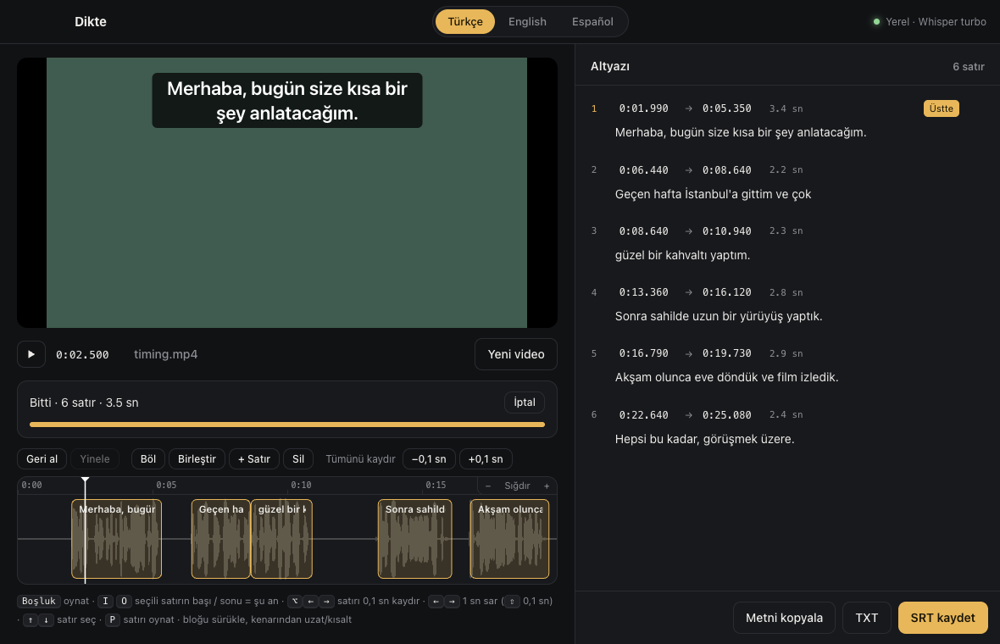

# Dikte

Videoyu sürükle, dili seç (Türkçe / English / Español), zaman damgalı altyazı (SRT) al.
Her şey **yerel** çalışır: ses bilgisayardan çıkmaz, ücret yok, dosya boyutu sınırı yok.

Altında [whisper.cpp](https://github.com/ggml-org/whisper.cpp) + Whisper `large-v3-turbo` (q5) modeli var; Apple Silicon'da Metal ile çalışır.
M2'de 30 saniyelik konuşma ~4-5 saniyede yazıya dökülüyor.



## Özellikler
- Sürükle-bırak, dosya seç ya da Dock ikonuna bırak / "Birlikte Aç"
- TR / EN / ES dil seçimi (dil değişince tek tıkla yeniden yaz)
- Konuşma algılama (Silero VAD): altyazılar sessizliğe taşmaz, cümle başı/sonu ~0,1 sn içinde
- Altyazıya uygun kısa satırlar (en fazla ~42 karakter, kelimeden bölünür)
- SRT ve TXT olarak kaydetme, metni kopyalama

### Altyazı editörü
- Dalga formlu zaman çizelgesi: bloğu sürükleyip taşı, kenarından uzat/kısalt (komşu satıra taşmaz)
- Başlangıç/bitiş kutularına zaman yaz ya da ↑/↓ ile 10 ms (⇧ 100 ms) ince ayar
- Oynatırken <kbd>I</kbd> / <kbd>O</kbd>: seçili satırın başını/sonunu o ana getir
- Böl, birleştir, yeni satır ekle, sil · tüm altyazıları birlikte ±0,1 sn kaydır
- Satırı ekranın **üstünde** gösterme (SRT'ye `{\an8}` olarak yazılır)
- Uyarılar: çakışma, çok kısa satır, okunamayacak kadar hızlı satır
- Sınırsız geri al / yinele (⌘Z / ⇧⌘Z)

| Kısayol | İş |
|---|---|
| <kbd>Boşluk</kbd> | Oynat / durdur |
| <kbd>I</kbd> / <kbd>O</kbd> | Seçili satırın başı / sonu = şu an |
| <kbd>P</kbd> | Seçili satırı oynat (sonunda durur) |
| <kbd>↑</kbd> <kbd>↓</kbd> | Önceki / sonraki satır |
| <kbd>←</kbd> <kbd>→</kbd> | 1 sn geri / ileri (<kbd>⇧</kbd> ile 0,1 sn) |
| <kbd>⌥</kbd><kbd>←</kbd> <kbd>⌥</kbd><kbd>→</kbd> | Seçili satırı 0,1 sn kaydır |
| <kbd>S</kbd> / <kbd>M</kbd> / <kbd>N</kbd> | Böl / sonrakiyle birleştir / yeni satır |
| <kbd>⌘</kbd><kbd>⌫</kbd> | Seçili satırı sil |
| <kbd>⌘</kbd> + tekerlek | Zaman çizelgesini yakınlaştır |

## İndir (macOS, Apple Silicon)
1. [Releases](https://github.com/atakankoprulu/dikte/releases) sayfasından `Dikte-x.y.z-arm64.dmg` dosyasını indir, `Dikte.app`'i Applications'a sürükle.
2. Gerekli araçları kur: `brew install ffmpeg whisper.cpp`
3. Uygulama Apple tarafından onaylı (notarize) değil. İlk açılışta macOS engellerse:
   **Sistem Ayarları → Gizlilik ve Güvenlik → "Yine de Aç"**, ya da terminalde:
   `xattr -dr com.apple.quarantine /Applications/Dikte.app`

## Kaynaktan çalıştırma
```bash
brew install ffmpeg whisper.cpp
npm install
npm start          # geliştirme
npm run dist       # dist/ altında DMG üretir
```
İlk açılışta model yoksa uygulama indirmeyi önerir (~550 MB, Whisper + VAD). Model şuraya iner:
`~/Library/Application Support/Dikte/models/`

Komut satırından doğrudan dosyayla açmak için: `npm start -- video.mp4`

## Lisans
MIT
